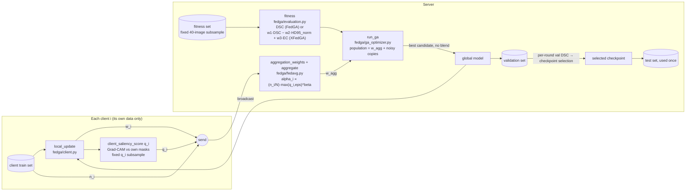

# XFedGA — architecture

XFedGA is federated learning with explanation-weighted aggregation and server-side genetic-algorithm (GA) search, for medical image segmentation.
- **Tasks:** breast ultrasound and prostate MRI.
- **Methods:** FedAvg, FedGA (baseline) and XFedGA. They differ only in the switches in `experiments/run_federated.py::METHODS`; the code paths are shared.

## Data flow of one round (custom loop, `experiments/run_federated.py`)

| Step | FedAvg | FedGA (baseline) | XFedGA |
|---|---|---|---|
| q_i on client | – | – | yes |
| aggregation | n_i / N | n_i / N | (n_i/N)·max(q_i, eps)^beta |
| GA search | – | yes, fixed sigma | yes, sigma annealed sigma0·exp(−g/tau) |
| fitness (fixed 40-image subsample) | – | DSC | w1·DSC − w2·HD95_norm + w3·EC |

## Where things live
| Path | Contents |
|---|---|
| `configs/` | one YAML per task: data paths, splits, **every hyperparameter** (validated in `experiments/config.py`) |
| `data/` | dataset indexers and loaders, the preprocessing cache (`cache.py`), three-way splits and fixed subsamples (`splits.py`) |
| `models/` | MONAI Residual U-Net |
| `fedga/` | **the algorithm**: client update and q_i (`client.py`), aggregation (`fedavg.py`), GA (`ga_optimizer.py`), fitness and metrics (`evaluation.py`), loss |
| `xai/` | Grad-CAM, EC (Grad-CAM–mask IoU at threshold 0.5), pointing game |
| `experiments/` | `run_federated.py` (custom loop), task/data assembly (`tasks.py`), config loading and seeding (`config.py`). (The pre-audit `train_*.py` scripts were removed; tag `legacy-scripts-final`.) |
| `fl_dist/` | (Session 3) Flower multi-process federation on a single machine over loopback gRPC; imports `fedga/` and `xai/`, holds no algorithm code |
| `analysis/` | scripts that turn `results/` into tables and figures |
| `results/` | runs (`runs/`), split logs (`splits/`), timing, audit outputs, legacy (superseded) outputs |
| `tests/` | pytest suite (`python -m pytest`) |

## Invariants (tested)
- Aggregation weights sum to 1; beta = 0 equals FedAvg (`tests/test_algorithm.py`).
- The GA never returns a candidate worse than w_agg on the fitness function (elitism; `tests/test_algorithm.py`).
- Fitness / validation / test sets are disjoint at patient (BUS-BRA) or case (Decathlon) level (`tests/test_splits.py`).
- The same seed gives the same model and metrics (`tests/test_determinism.py`).
- Cached preprocessing equals on-the-fly preprocessing exactly (`tests/test_cache.py`).
